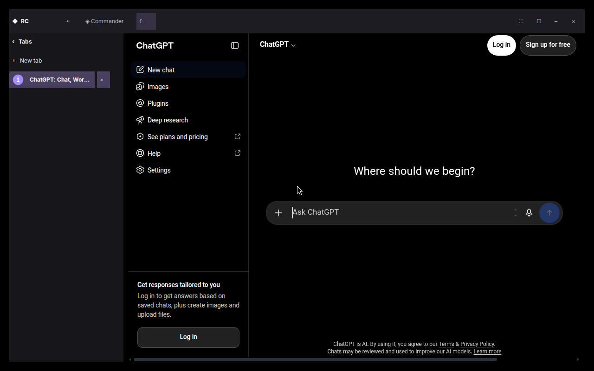
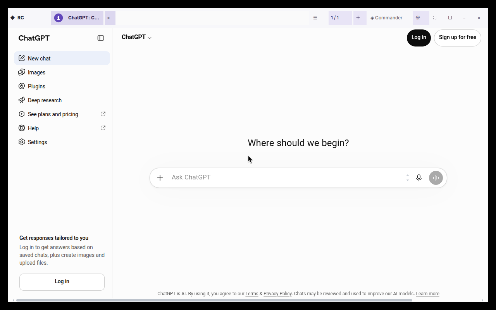

# Remote Commander Browser — Minimal native chrome (Brave-inspired) · draft

**Scope**: A visual redesign of the existing CEF Views shell only. No Brave source code/assets, no impersonation of Brave branding, no extra browser renderer, no profile migration, no ChatGPT DOM injection. This is a proposal for the owner's Browser UI branch; **not** a Stable release.

## Visual specification

- **Quiet neutral light**: top bar #F7F7FA, left rail #F0EFF4, off-white inactive tabs and gently violet selected row #DCD7EF, charcoal body text #25232B.
- **Editorial dark**: top bar #1D1C22, deeper rail #17161B, content #141317, selected row #49405F, readable off-white / muted lavender text.
- Accent violet #6247B9 / #A58CFF is used sparingly, not applied as a broad solid background.
- 52-DIP native window header preserved for compatibility; action-height 36 DIP; compact wordmark; 42-DIP theme/orientation controls; 34-DIP icon controls. The two reorder buttons appear only if >1 tab in horizontal mode, but keyboard tab ordering remains intact.
- 54-DIP compact rail and expanded 246-DIP rail preserved; tighter 4–5-DIP row rhythm, with a 26-DIP circular ordinal badge (already cached at scale 1/2). Dark/light themes preserve contrast, active tab emphasis, RTL-friendly Vazirmatn and Inter.
- Header actions have tooltips and screen-reader names. No critical control is removed, no loss of Companion, full screen, min/max/close, Ctrl+Tab, Ctrl+T, Ctrl+W, tab orientation, reordering or theme toggle. State persistence and security model unchanged.
- Avoid a second HTML/webview UI layer: additional memory/CPU and a risk to the original authenticated ChatGPT profile are incompatible with the project constraints.

## Design review: references and constraints

- Brave's official desktop appearance / custom toolbar: https://brave.com/whats-new/customize-appearance/
- Brave official vertical tabs / collapsible rail: https://brave.com/blog/vertical-tabs/
- Brave Github contrast and compact-rail issue: https://github.com/brave/brave-browser/issues/52389
- CEF Views native buttons expose background color, image, font and tooltips but no general corner-radius control; this candidate is **visually inspired, not yet pixel-identical**. The long-term optional corner radius/hover chip would require a separately validated native CEF drawing layer and should not compromise BrowserView lifetime.
- No copying of Brave iconography, code, brand mark, or copyrighted assets.

## Acceptance gates

1. Build cleanly against project-pinned CEF on Linux, verify no missing shared library, no new executable/process or external UI dependency.
2. Native stylesheet contrast test checks WCAG ≥4.5:1 for normal text in light/dark including selected tab and rail. Preserve keyboard and accessibility assertions.
3. Existing Cppcheck/Static QA + Node suite + companion CTest + release integrity pass.
4. Isolated Xvfb GUI with a fresh **non-authenticated profile**: both orientations, compact/expanded rail, light/dark state change, full screen and tab close/new tab, clean exit, no child-process fatal diagnostics. Do not disable Chromium sandbox; use owner-approved **PR #96 stack guard** in QA staging only until unified.
5. GUI screenshot design inspection at 1280×800 and narrower window; owner acceptance for polished visual geometry, color, English/Persian typography and other platform.
6. On Emad development hosts: exact-head Windows/Linux CI, profile preservation, long session, rollback and release authorization before any fleet update.

**Dependency:** https://github.com/Usefull-Skills/remote-commander-browser/pull/96 (Linux CEF fork stack guard). **Current UI parent:** https://github.com/Usefull-Skills/remote-commander-browser/pull/103. Do not replace the installed preview on MMZ QA until owner acceptance.

## Actual QA screenshots — anonymous isolated Linux profile

These are real captures of the compiled CEF Views binary in an isolated Xvfb display (not generated mockups). They contain no user session or credentials.

The CEF Views control backgrounds are still rectangular; these visuals demonstrate a modern neutral appearance, not pixel-perfect Brave button radii.
