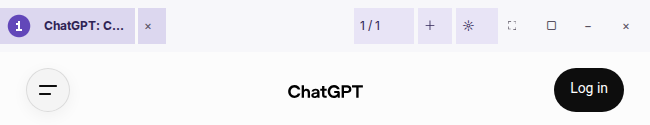

# Brave-inspired Native Chrome — responsive narrow-window follow-up

**Base:** PR #106, commit 964d96170a66aac7d85af6c9621e3adffa2c323b. Stacked review, not a stable release.

The parent PR already implements the visual palette, compact controls, actual screenshots and Linux/Windows CI. This follow-up intentionally does **not** duplicate those changes.

## Verified improvement

- At under 930 native logical pixels, hide secondary tab-reorder arrows and the visual Commander shortcut; **Ctrl+Shift+PgUp/PgDn** and **Ctrl+Shift+C** still work.
- At under 690 logical pixels, hide brand and orientation decoration. **Ctrl+Shift+E** still changes orientation. Window management, theme, new tab and tab switcher remain available.
- Track whether these width tiers changed in `OnWindowBoundsChanged`, so layout reconciles once on transition even when the tab-capacity count did not change. No constant CEF view detach/reparent during every pixel of live resize.
- A hovered selected tab retains its selected background in both horizontal and vertical mode.
- Do not change window dimensions, app identity, cookies, session, Chromium sandbox, origin restrictions or Commander transport.

## Acceptance

- Node and accessibility regression tests for native actions and responsive tiers.
- **Verified (local follow-up source):** pinned CEF 154 Linux clean Build 217/217, no missing shared libraries, static/cppcheck PASS, Node 44/44 PASS, release integrity 16/16 PASS and Companion CTest 2/2 PASS.
- Exact-head Linux and Windows CI on GitHub.
- Manual owner GUI resize at 650, 800 and 1280+ DIP and fullscreen/RTL acceptance remains **OPEN**: the currently connected Remote Commander shell explicitly blocks direct OS mouse/window input mutation.
- Draft until integration of CEF stack-guard PR #96, Emad owner acceptance, signed/unsigned release policy and transactional rollback. This follow-up does not attempt a new Browser installation.

References: PR #106 (design), PR #103 (Native tabs), PR #96 (CEF stack guard), Issue #105 (subprocess fatal).

**Scope boundary:** The isolated Linux follow-up binary built from PR #106 does not yet contain the separate Linux CEF #3912 stack-guard fix from PR #96. Native runtime without that dependency is not qualified as clean; do not treat compiling as native acceptance.

## Acceptance evidence — 2026-10-16 19:55 Tehran

**Exact PR #107 commit `28247d5e40caca16ca61b9b40b7fc54e3254e05d`:** GitHub Actions `Build` run `38927721393` (Linux release build, real native X11 drag, companion checks) and `Windows native preview` run `38927720759` (Windows native lifecycle and isolated installer acceptance, Linux regression) both **concluded success**. Source-based tests: Node 44/44, Static/cppcheck, Release Integrity 16/16 and companion CTest 2/2.

**Separate isolated Linux QA candidate only:** exact PR #107 source plus a *non-deployed* Linux-only `NO_STACK_PROTECTOR` annotation from PR #96, CEF 154 clean 217/217 Release build SHA-256 `ef073e1d09daf87154c871fd35233dbb0528c9ea30fbbae36bfd7fffbe9e27f6`. Preserved original root-owned 4755 Chromium sandbox; used a new unauthenticated temporary profile and Xvfb display (no session changes). Native window actually resized to **1280, 800, 650 logical pixels** via X11, with verified exact actual widths and image evidence below; native main and shutdown trigger exited 0 and fatal stdout/stderr was 0. A separate native run passed vertical, fullscreen and **24-cycle tab-lifetime** markers with main/trigger exit 0 and 0 fatal stdout/stderr.

Screenshots were cropped from **real CEF/Xvfb** in unauthenticated temporary QA, not generated. Visible 650px chrome retains its tab, tab creation, theme and window controls. These results close the **isolated Linux/X11 resize behavior** gate; they do **not** establish owner desktop/Wayland visual acceptance or signed Stable production readiness.

**Open:** owner Emad's real desktop/RTL/accessibility and Brave appearance review, Linux + Windows feature integration (PR #96 → #103 → #106 → #107), release policy and transactional install/rollback. PR #107 stays Draft; deployed browser and ChatGPT/Brave profiles were not changed.
